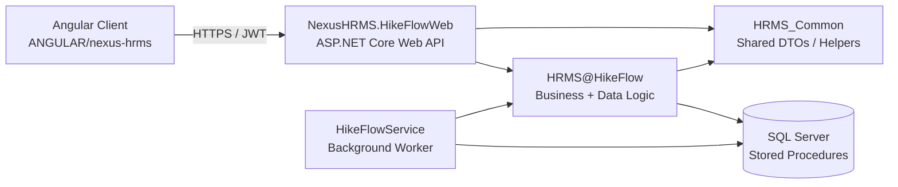
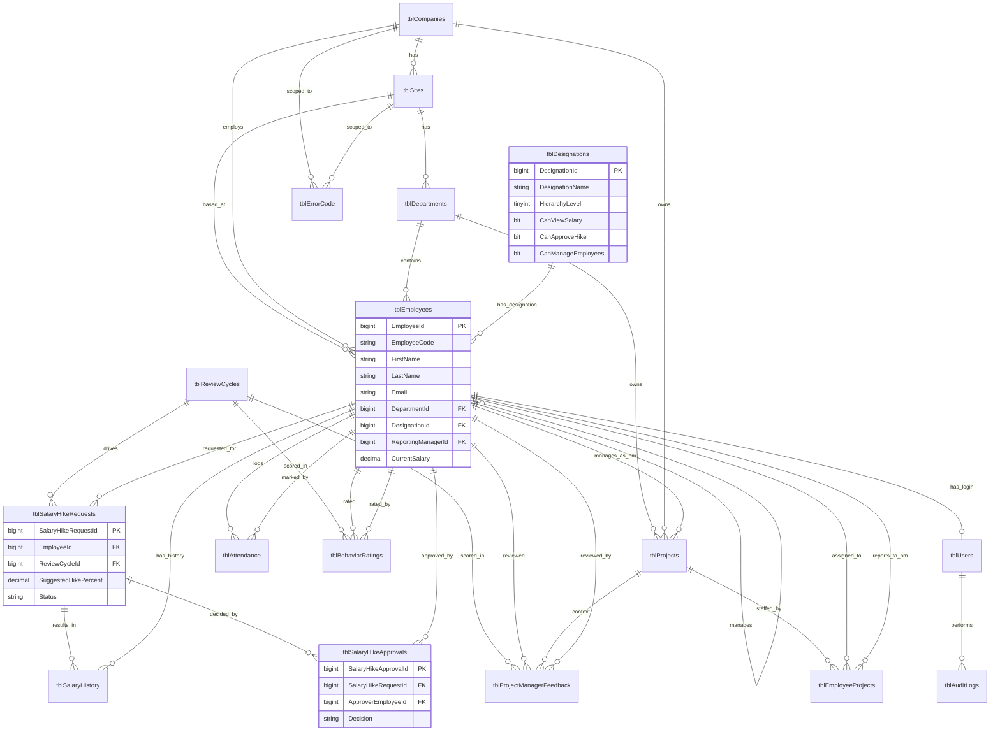

# NexusHRMS

**Role-Based Human Resource Management System** — ASP.NET Core Web API, Angular, and SQL Server, with a HikeFlow salary-review and approval workflow at its core.


---

## Project Overview

NexusHRMS models a real organizational workflow: employee onboarding, project staffing, attendance, dual-input performance reviews, and a two-stage salary hike approval process (HikeFlow) — all gated behind a data-driven, designation-based permission model rather than hardcoded roles.

Built to reflect real-world employee relationship complexity rather than a simplified CRUD demo — the goal is a system with genuine scope to keep expanding (more workflows, more edge cases, more realistic HR scenarios) as a way to keep developing and exposing myself to production-grade feature work.

## Current Development Status

This project is **actively under development**. The database schema, stored procedures, and core API layer are functional; the HikeFlow business workflow and full frontend integration are being built incrementally.

| Area | Status |
|---|---|
| Database schema, stored procedures, indexes | ✅ Implemented |
| ASP.NET Core Web API (employee CRUD, auth) | ✅ Implemented |
| JWT authentication (login, refresh) | ✅ Implemented |
| HikeFlow business logic (`HRMS@HikeFlow`) | 🔧 In active development |
| Angular ↔ API integration | 🔧 In progress (incremental, page by page) |
| Frontend UI/UX, validations | 🔧 In progress |
| Background worker (`HikeFlowService`) | 🔧 In progress |
| Automated tests | ⏳ Planned |

## Architecture



The API (`NexusHRMS.HikeFlowWeb`) is a thin host layer — routing, controllers, and JWT auth only. Business rules and data access live in `HRMS@HikeFlow`, shared by both the API and the background worker (`HikeFlowService`) so logic isn't duplicated between the two entry points. `HRMS_Common` holds shared DTOs/constants/helpers with no dependencies of its own. All data access goes through SQL Server stored procedures rather than an ORM.

## Technology Stack

| Layer | Technology |
|---|---|
| Frontend | Angular |
| Backend API | ASP.NET Core Web API (C#) |
| Business/Data Layer | .NET Class Library (`HRMS@HikeFlow`) |
| Background Processing | .NET Worker Service (`HikeFlowService`) |
| Database | Microsoft SQL Server (T-SQL stored procedures) |
| Auth | JWT (access + refresh tokens) |
| Data Access | ADO.NET (stored procedures, no ORM) |

## Solution Structure

```
NexusHRMS
│
├── NexusHRMS.HikeFlowWeb
│   └── ASP.NET Core Web API
│       ├── API endpoints
│       ├── Controllers
│       ├── Middleware
│       └── Application hosting/configuration
│
├── HRMS@HikeFlow
│   └── Class Library
│       ├── Business Logic
│       ├── Data Access
│       └── HikeFlow domain logic
│
├── HRMS_Common
│   └── Shared Components
│       ├── DTOs
│       ├── Constants
│       ├── Common Helpers
│       └── Shared Models
│
├── HikeFlowService
│   └── Worker Service
│       └── Background / scheduled processing
│
├── DATABASE
│   └── SQL Server
│       ├── Tables
│       ├── Stored Procedures
│       ├── Functions
│       └── Database Scripts
│
└── ANGULAR
    └── nexus-hrms
        └── Angular Frontend
```

Project names reflect the codebase's original working title (HikeFlow) and are kept unchanged to avoid touching live `ProjectReference` paths and namespaces across a working solution.

## API Layer — `NexusHRMS.HikeFlowWeb`

- Exposes REST endpoints consumed by the Angular client
- Handles JWT issuing/validation and request routing
- Delegates all business rules and data access to `HRMS@HikeFlow` — controllers stay thin
- Current endpoints wrap stored procedures including employee search/create/update/delete, auth (login, token refresh), and error-message lookup

## Business & Data Access Layer — `HRMS@HikeFlow` / `HRMS_Common`

- `HRMS@HikeFlow`: business rules and data access, including the HikeFlow salary-review and approval workflow — **primary area of active development**
- `HRMS_Common`: shared DTOs, constants, and helper utilities referenced by every other project, with no outgoing dependencies

## Angular Frontend — `ANGULAR/nexus-hrms`

- Consumes the Web API over HTTPS with JWT-based auth
- Pages/integration are being built incrementally against the API as endpoints stabilize
- Some pages, form validations, and UI styling are still in progress

## HikeFlow Worker Service — `HikeFlowService`

- .NET Worker Service for background/scheduled processing (e.g. periodic salary-hike eligibility checks)
- Shares business logic with the API via `HRMS@HikeFlow` rather than duplicating it

## Database

SQL Server schema organized around five areas:

| Area | Tables |
|---|---|
| Organization | `tblCompanies`, `tblSites`, `tblDepartments`, `tblDesignations` |
| People & Access | `tblEmployees`, `tblUsers` |
| Work | `tblProjects`, `tblEmployeeProjects`, `tblAttendance` |
| Performance & Compensation | `tblReviewCycles`, `tblBehaviorRatings`, `tblProjectManagerFeedback`, `tblSalaryHikeRequests`, `tblSalaryHikeApprovals`, `tblSalaryHistory` |
| System | `tblAuditLogs`, `tblErrorCode` |

All application data access goes through stored procedures (e.g. `usp_GetEmployees`, `usp_InsertEmployee`, `usp_UpdateEmployee`, `usp_DeleteEmployee`) rather than direct table access from application code.

## Authentication & Authorization

- Login and token refresh are handled by `usp_GetUserForAuth` and `usp_GetUserByIdForRefresh`, returning the employee's designation alongside credentials in one round trip
- Passwords are stored as hashes (`tblUsers.PasswordHash`) and changed via `usp_ChangePassword`
- **Authorization is data-driven, not role-string-based:** permissions come from `tblDesignations` flags —

| Flag | Controls |
|---|---|
| `CanViewSalary` | Access to salary fields and salary history |
| `CanApproveHike` | Ability to act on salary hike requests |
| `CanManageEmployees` | Create/update/delete employee records |

## API Integration

Angular communicates with the API over JWT-authenticated HTTPS calls. Integration is being built incrementally — core employee management endpoints are wired up first, with HikeFlow-specific screens (salary hike requests/approvals) following as that business logic lands in `HRMS@HikeFlow`.

## ER Diagram



## Project Roadmap

- [x] Core database schema, seed data, indexes
- [x] Employee management API (search, create, update, delete)
- [x] JWT authentication + refresh flow
- [ ] Complete HikeFlow business logic (`HRMS@HikeFlow`)
- [ ] Full Angular ↔ API integration for all modules
- [ ] Background worker (`HikeFlowService`) scheduled jobs
- [ ] Automated test coverage
- [ ] CI/CD pipeline (`.github` workflows)

## How to Run

### Prerequisites
- .NET SDK 10.0.401
- Node.js v22.22.2 + Angular CLI
- SQL Server _(version)_

### Setup
```bash
# 1. Clone
git clone https://github.com/mahen543/NexusHRMS.git
cd NexusHRMS

# 2. Database
# Run scripts in DATABASE/ in order: schema -> seed data -> stored procedures -> indexes

# 3. Backend (API)
cd NexusHRMS.HikeFlowWeb
dotnet restore
dotnet run

# 4. Background worker (optional, separate process)
cd HikeFlowService
dotnet run

# 5. Frontend
cd ANGULAR/nexus-hrms
npm install
ng serve
```

### Configuration
Add your connection string and JWT settings to `appsettings.json` (see `appsettings.Example.json`).

## Development Notes

- Project folder names (`HikeFlowService`, `HRMS@HikeFlow`, `HRMS_Common`, `NexusHRMS.HikeFlowWeb`) are historical and intentionally unchanged to avoid breaking existing `ProjectReference` paths and namespaces.
- Data access is stored-procedure-based throughout — no direct ad-hoc SQL from application code.
- `HikeFlow business logic is currently under active development.` The ASP.NET Core Web API, database integration, shared components, and Angular API communication are being developed incrementally. Some frontend pages, validations, UI design, and HikeFlow-specific business workflows are still in progress.

## License

MIT — see [LICENSE](LICENSE).
